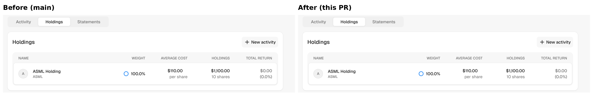
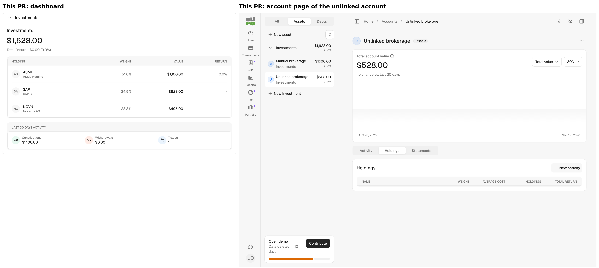
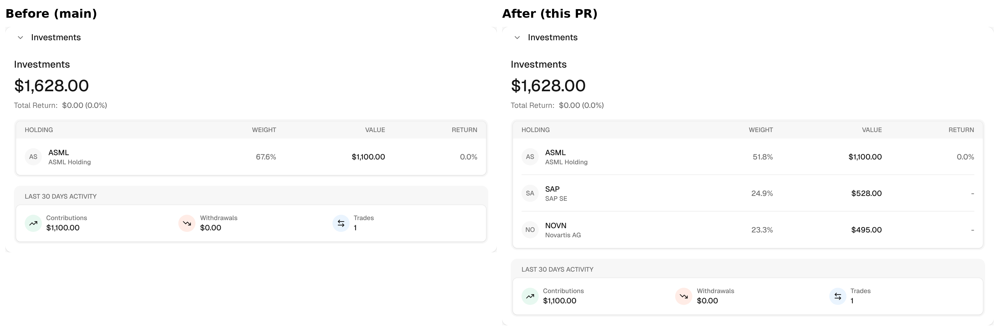

I reviewed head def0874 and reproduced each point with a test.

**1. The premise does not hold on main, so this does not fix #2782.** `Holding::PortfolioCache#get_price` converts every price to the account currency and always returns `currency: account.currency` (with no rate it keeps the raw price 1:1, still labelled in the account currency). `ForwardCalculator` copies that currency, so calculated rows are always in the account currency. I tested a USD account with a EUR-priced security and a EUR trade. After `Holding::Materializer`, every row is USD on both main and this branch, and the position already shows in `InvestmentStatement#current_holdings`. #2782 asks for the opposite: keep the manual holding in its own currency. That is unchanged here. The new test creates a foreign-currency row directly, which the calculation never produces.

Manual account with a EUR trade, holdings tab, identical before and after:

**2. Dashboard and account page would disagree.** `Account#current_holdings` (account page, `current_holdings_total`) still filters `where(currency: currency)`. With this change, a manual account with a foreign-only row shows it on the dashboard but not on the account page. Open PR 5043 documents this query as returning the same rows as `Account#current_holdings`.

**3. Sold positions come back after a provider is unlinked.** The real source of foreign-currency rows without `account_provider_id` is an unlinked provider: the unlinking modules and `dependent: :nullify` clear the column, and providers store positions in their own currency. In a test with a EUR provider on a USD account, a security last reported three days ago (sold) shows up again on the dashboard after unlinking. On main it does not. The next sync usually cleans this up, but until then the dashboard shows a position that no longer exists. Below, NOVN was sold before the unlink; the listed holdings now add up to more than the portfolio value.

Screenshots use demo data (family currency USD, 1 EUR = 1.10 USD).

Suggestion: either address #2782 at the source (store manual holdings in their own currency and treat them the same way in `Account#current_holdings`), or keep the account-currency rule and drop `Fixes #2782`.

---
_Generated by [Claude Code](https://claude.ai/code)_
