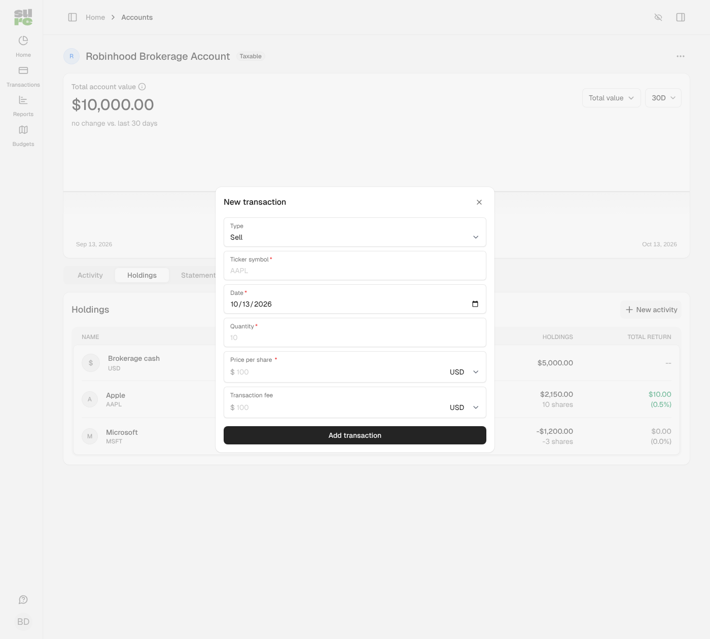
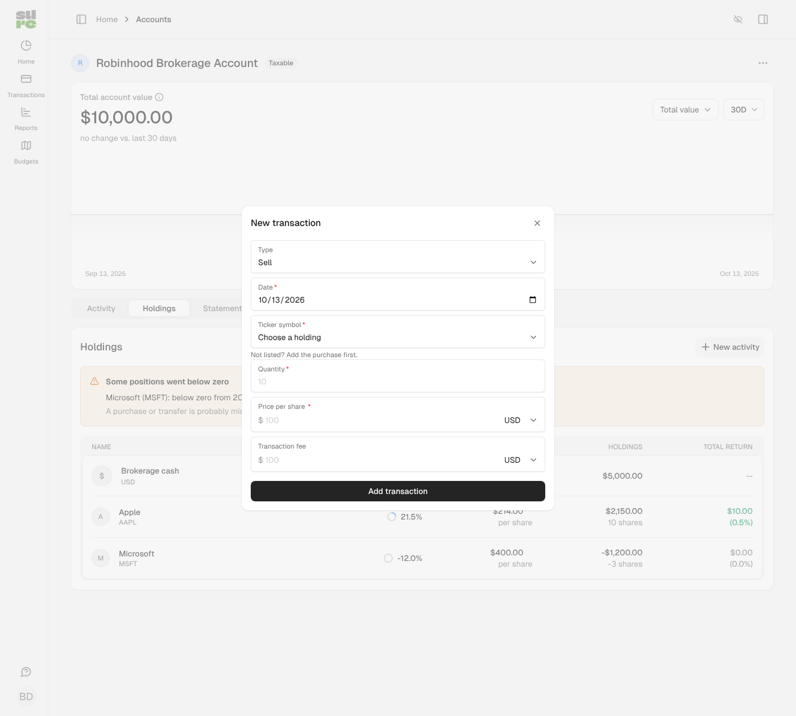
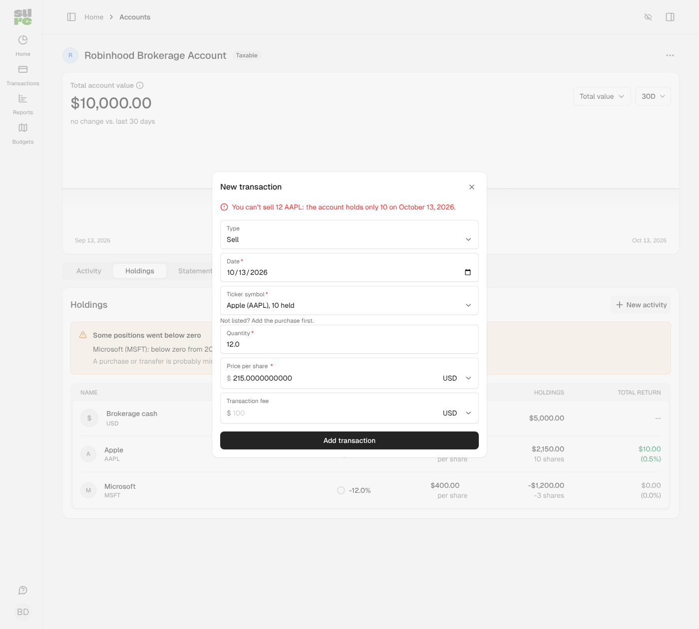
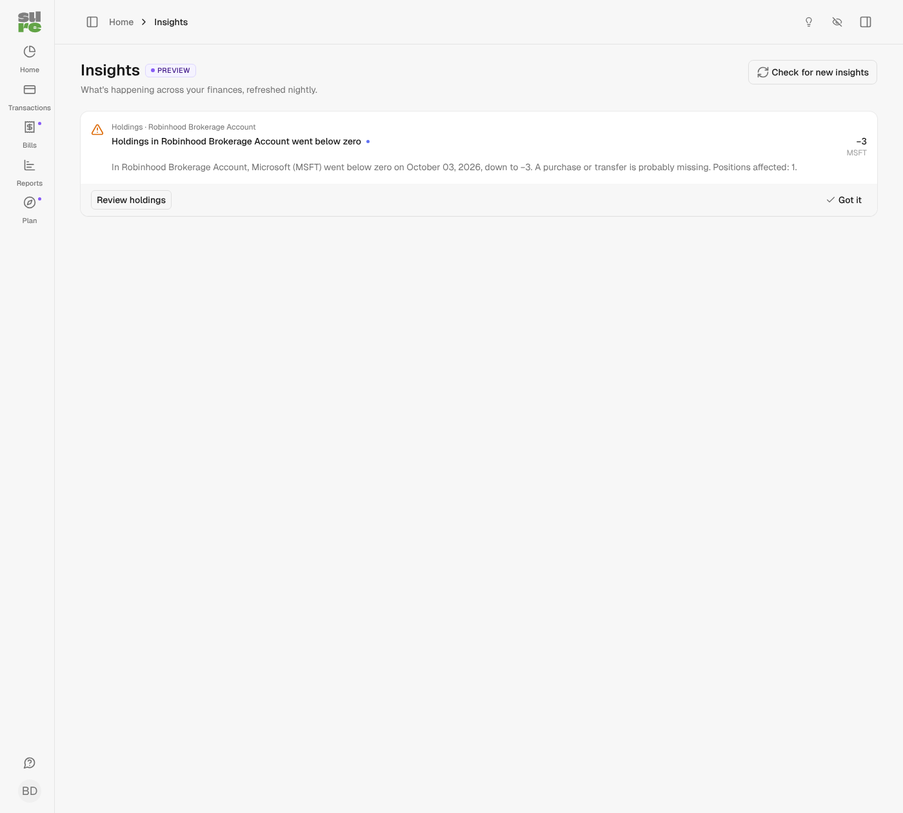

Depends on #4185 and is stacked on it: the base branch is the head of #4185, so the diff shows only the sale limit. Once #4185 is merged, this PR can be retargeted to `main`.

#4185 now only warns about positions that went below zero. This PR adds the second part that review asked to split out: refusing sales that would take a position below zero. It is a separate decision, so it can be discussed (block, or save and warn) without holding up the warning.

Before: the sell form uses the global security search, so any ticker can be sold, including one the account never held. Selling more than the position (or back-dating a sale before the purchase) is saved silently and the holdings go below zero.

After: the sell form asks for the date first and then offers only what the account holds on that date, with the quantity ("Apple (AAPL), 10 held"). A sale that would take the position below zero on any day from its date on is refused with a clear message and nothing is saved. Positions that went below zero through imports or syncs also show up as an insight in the insights feed.

## Behavior

- The sell picker lists the securities held on the chosen date. For a date after today it also counts purchases dated between today and that date.
- An oversold sale is a validation error; nothing is saved.
- The limit is the holding on the sale date, and the position must also stay at or above zero on every later day, including future-dated trades. Splits are taken into account, in exact split units.
- The same check runs when a sale is edited. Edits that only shrink an existing sale (same date and security) are not checked, so already-oversold data stays editable. The comparison uses the stored sale read under the account lock.
- A bulk date edit saves the whole batch first and then checks every sale against the final state, so a purchase moved together with its sale passes in any row order. One refused sale rolls back the whole batch.
- Deleting or editing purchases is not blocked, and imports and provider syncs are not checked. Negative positions from those show as the warning from #4185 and as an insight.

## Which paths are checked

| Path | Checked |
| --- | --- |
| Trade form: new sale | yes |
| Trade drawer: edit (qty, date, security, buy to sell) | yes |
| API `POST /api/v1/trades` (via `Trade::CreateForm`) | yes |
| API `PATCH /api/v1/trades/:id` | yes (422) |
| Convert transaction to trade | yes |
| Bulk edit moving a sale's date | yes |
| CSV import, provider sync | no (warning on the holdings tab and in insights) |
| Linked accounts | never refused: the provider's holdings are the truth from today backwards, so a hand-recorded sale only raises earlier days |

## How

- `Trade::SaleLimit` computes the position without the sale via `Holding::ForwardCalculator` (scoped to one security, able to exclude the edited entry), converts later days through splits and compares the sold quantity with the lowest day from the sale date on. Check and save run under a lock on the account row, so two concurrent sales cannot count the same units.
- `Account#held_securities_on(date)` feeds the picker: on a linked account the latest provider snapshot on or before the date, otherwise the latest calculated row per security. The picker reloads in a Turbo frame when the date changes. `Trade::CreateForm` only accepts a standard security the account holds or has traded.
- `Insight::Generators::NegativePositionGenerator` (type `negative_position`, medium priority, at most two accounts, only accounts every active member can see, provider-reported short positions ignored). An acknowledged warning whose numbers did not change gives its slot to another account. Where this kind of signal should live in the long run is open in #5162; this generator can be dropped or moved once that is decided.

## Downstream effects

- Assistant and MCP tools that create trades through `Trade::CreateForm` get the same refusal.
- API clients that sell without a prior buy now get 422. Scripts that push a broker's history newest first need to send purchases first.
- `Insight::TYPES` gains `negative_position`.

## Screenshots

| | Before | After |
| --- | --- | --- |
| Sell form |  |  |
| Selling 12 of 10 held | saved, position goes negative |  |
| Insights feed | no insight |  |

## Validation

- `bin/rails test`: 15722 runs, 0 failures, 0 errors.
- Tests: `test/models/trade/sale_limit_test.rb`, `test/models/insight/generators/negative_position_generator_test.rb`, plus trades, API trades, conversion, bulk update, account and i18n tests and a system test for the sell picker.
- rubocop, erb_lint and Brakeman are clean.

🤖 Generated with [Claude Code](https://claude.com/claude-code)
