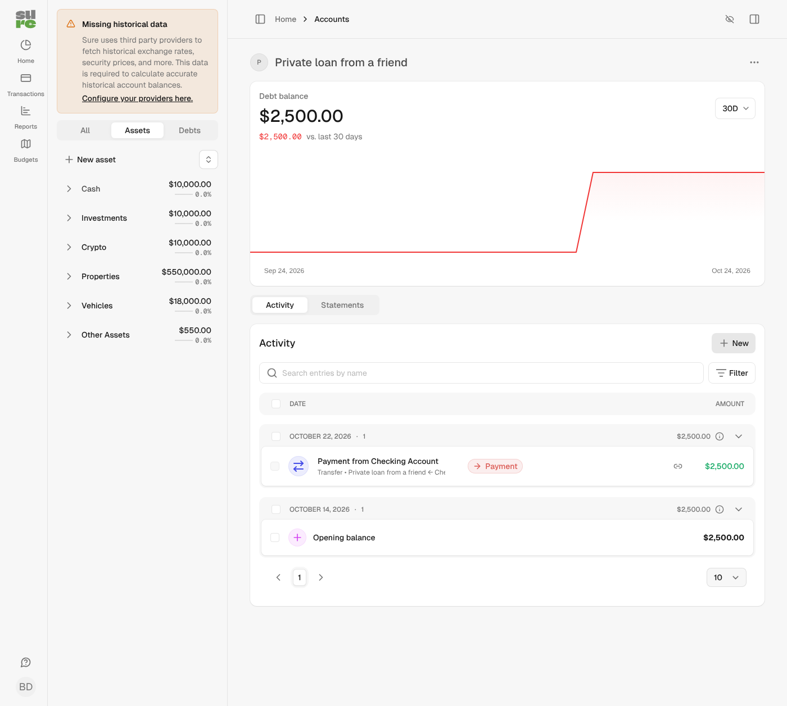
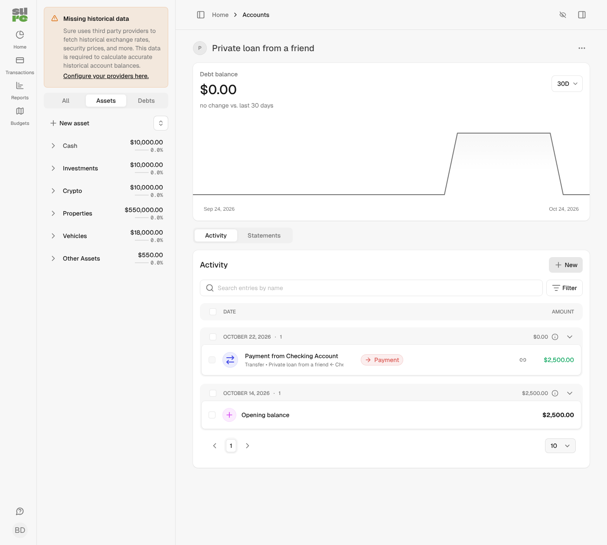

Closes #1192

## Problem

Other assets and other liabilities are valuation-tracked: their transactions never touch the balance. That is a deliberate design. But the transfer form lets you transfer into these accounts and shows the transfer as a payment. The money leaves the source account, while the other liability (or other asset) keeps its old balance, so **the money vanishes from net worth**.

Example: checking 2,500, a private loan from a friend 2,500 (other liability). Pay it back by transfer. Before this change, checking drops to 0, the debt stays at 2,500, and net worth falls by 2,500 although only a debt was repaid. The only workaround was to also set "New balance" on the liability.

## Changes

- `Balance::BaseCalculator`: for other assets and other liabilities, legs and fees of **confirmed transfers** now move the non-cash balance, in the forward and the reverse calculator. Standard transactions stay ignored, and so do pending auto-matches and unmatched rows that only carry a transfer kind (e.g. a provider's `funds_movement`). Loans keep counting every transaction; property and vehicle are unchanged. The confirmed-transfer ids are loaded once per calculation.
- `Account#balance_counts_transfers?` holds the account type list.
- `Transfer` resyncs these accounts after commit when a transfer is confirmed or a confirmed transfer is removed (unlink, reject, deleting a leg or the counterpart account). Running after commit keeps callers that confirm inside their own transaction from locking an account row while holding theirs. Pending matches and other account types trigger no extra sync.
- Unlinking or rejecting a confirmed transfer now also needs write access to an endpoint whose balance counts transfers, since unlinking moves that balance (same rule as for fee accounts).
- `UI::Account::BalanceReconciliation`: the day breakdown for these accounts includes the transfer movement with the account's sign, so start + flow = end.
- The other-asset form notice says transfers still change the balance (all locales).
- The payment keeps its kind (`cc_payment`), so budgets and the income statement are unchanged.

## Screenshots

Other liability opened at $2,500, then paid back with a $2,500 transfer from checking (demo data).

| Before | After |
|---|---|
|  |  |

## Notes

- Existing accounts pick the change up on their next sync; there is no migration. Their history (net worth, balance sheet, charts) is recalculated then.
- A "New balance" entered on or after the payment date still wins. One dated before a later payment now has that payment applied on top.
- Deleting the account that paid removes the transfer; the leg on the liability becomes a standard transaction and stops counting.

## Validation

- Forward and reverse calculator tests with a real confirmed transfer, a standard transaction and an unmatched `funds_movement` row; a `Transfer::Creator` payoff reaching 0; a destination fee. These fail on main.
- Transfer tests: resync on confirm, unlink and leg deletion, none when a pending match is rejected. Controller tests for the unlink permission.
- Balance, transfer, account, component and assistant tests, RuboCop, Brakeman: clean.

🤖 Generated with [Claude Code](https://claude.com/claude-code)
