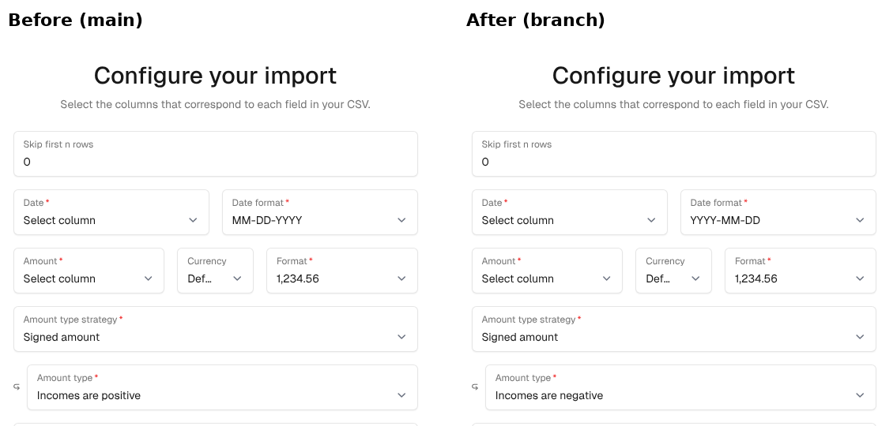

Closes #1092

## Problem

Re-importing Sure's own `transactions.csv` export flips every amount, so expenses come back as income and both legs of a transfer change direction.

`transactions.csv` writes the stored entry amount (outflows positive, inflows negative). A new transaction import defaults to "Incomes are positive", the convention of the UI and the import template. Exporting and re-importing with the preselected settings therefore negates every row.

Changing the export's sign would break external scripts and older exports, so this PR adapts the import instead, as discussed for the earlier export change.

## Changes

- When an uploaded CSV's header contains every `transactions.csv` export column, the upload preselects the export's settings: "Signed amount" with "Incomes are negative", ISO dates (`%Y-%m-%d`), plain decimals (`1,234.56`) and no skipped rows. The settings stay visible and editable in the configuration step.
- Header matching is case-insensitive, ignores a UTF-8 BOM and allows extra columns. The exporter and the detection share one constant (`Family::DataExporter::TRANSACTIONS_CSV_HEADERS`), so they cannot drift apart.
- Covered entry points: the web upload (`Import::UploadsController`) and drag-and-drop on the transactions list (`ImportsController#create`).
- Applying a suggested template from an earlier bank import keeps the export's settings and column names in one save, instead of the bank's sign, formats, labels and skipped rows.
- Replacing an uploaded export with another CSV restores the default sign and the family's date format.
- The export itself is unchanged.

Not changed on purpose: API v1 `POST /api/v1/imports` keeps its explicit configuration, since changing what an omitted parameter means would change the v1 contract.

## Screenshots

Configuration step right after uploading a `transactions.csv` export (demo data). Before: "Incomes are positive" and the family date format are preselected. After: "Incomes are negative" and YYYY-MM-DD.

## Notes

- A non-Sure file that happens to carry all eight export column names (including `account_name`) gets the export settings preselected. They are shown and can be changed before applying. The import template uses `account`, not `account_name`, and is not matched (tested).
- Re-imported transfer legs keep their direction; the transfer link itself is not recreated by a CSV import, as before.

## Validation

- `Import::UploadsControllerTest` exports a confirmed transfer, uploads the resulting `transactions.csv` through the web upload, submits the preselected configuration and checks both legs keep their stored sign. It fails on main (`Expected: 100, Actual: -100`).
- Model and controller tests for drag-and-drop, BOM, template application (sign, formats, labels, skipped rows), replacing an export and the import template.
- `bin/rails test` for the import models and controllers, RuboCop, Brakeman: clean. No view or JS changes.

🤖 Generated with [Claude Code](https://claude.com/claude-code)
