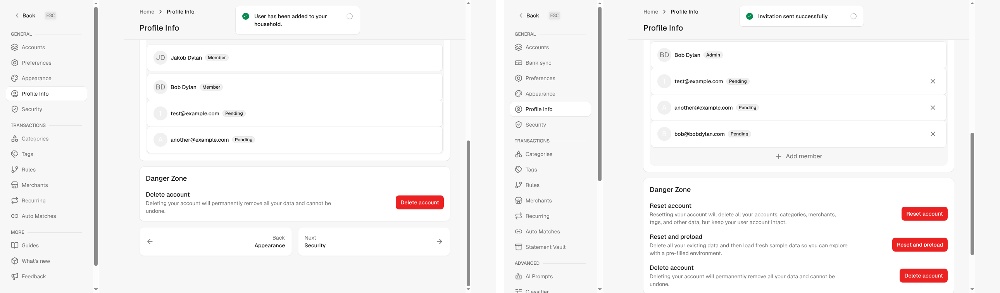
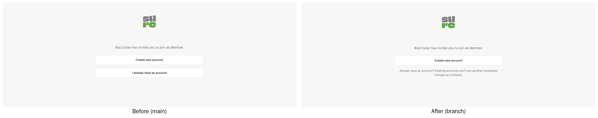

Closes #1206
Closes #3884

## Problem

When an admin invited an email that already belonged to a user, `InvitationsController#create` accepted the invitation on the spot. `Invitation#accept_for` then overwrote the user's `role` and `family_id`, with no check whether the user agreed or was already in the same household:

1. **Admin invites their own address as Member**: the admin is demoted immediately. If they were the only admin, the household has no admin left and there is no UI to undo it.
2. **Admin invites a current member as Admin, or another admin as Member**: the role changes silently.
3. **Super admin invites their own address**: as the last super admin, the request ends in an error page; otherwise they lose super-admin rights.
4. **Any existing user** can be moved into another household without consent.

The same `accept_for` also ran after every sign-in (password, passkey, MFA, OIDC, OIDC account linking) when a pending invitation token was stored in the session.

## Changes

Every user belongs to exactly one family (`users.family_id` is `NOT NULL`), so an invitation can only be used to **create** an account:

- `InvitationsController#create` no longer auto-accepts. Creating an invitation works and answers the same way for every email ("Invitation sent"), so an admin cannot use the form to probe which emails have an account on the instance.
- The sign-in paths no longer accept a pending invitation (`accept_pending_invitation_for` and `store_pending_invitation_if_valid` are removed).
- `Invitation#accept_for`, `would_orphan_owned_accounts?`, `release_provider_item_ownership` and the now-unused `ProviderItemOwnable.owned_item_classes` are removed.
- The accept page only offers "Create new account" plus a hint that existing accounts can't join another household through an invitation. If an account already exists for the invited address, the button is hidden, since sign-up would fail with "email taken". The check is case-insensitive also without Active Record encryption.
- Moving an existing user to another household stays possible through the super-admin user management (`transfer_to_family!`).

New users joining through an invitation work exactly as before: token registration, OIDC JIT and mobile SSO, including auto-sharing of accounts.

## Screenshots

Admin invites their own address as Member (demo data). Left (before): "User has been added to your household" and the admin is now a Member. Right (after): the usual "Invitation sent", the admin stays Admin.

Accept page:

## Paths checked

| Path | Before | After | Test |
|---|---|---|---|
| Web: create invitation | auto-accept for existing users | invitation sent, nobody moved | controller tests (other user, own email, current member, super admin) |
| Password sign-in with token | `accept_pending_invitation_for` | removed | controller test |
| Passkey sign-in with token | same | removed | controller test |
| MFA, OIDC sign-in, desktop exchange, OIDC link | same | removed | – |
| Accept page | create + sign-in buttons | create only + hint; hint only if account exists | controller tests |
| Token registration, OIDC JIT, mobile SSO | new user | unchanged | existing tests |
| Super-admin user management | direct transfer | unchanged | – |

## Notes

- No migration. Pending invitations that point at an existing account can no longer be accepted and expire as usual; admins can delete them earlier.
- Someone who signed up on their own before being invited can no longer join a household by invitation; a super admin can move them in Admin > Users.
- Pre-existing, not changed: the `inviter_is_admin` validation never adds an error; the controller performs the admin check itself.

## Validation

- The controller tests for own email, current member and other existing users fail on main and pass here.
- Invitation, session, passkey, MFA, OIDC, registration and API auth tests, RuboCop, ERB lint, Brakeman: clean.

🤖 Generated with [Claude Code](https://claude.com/claude-code)
