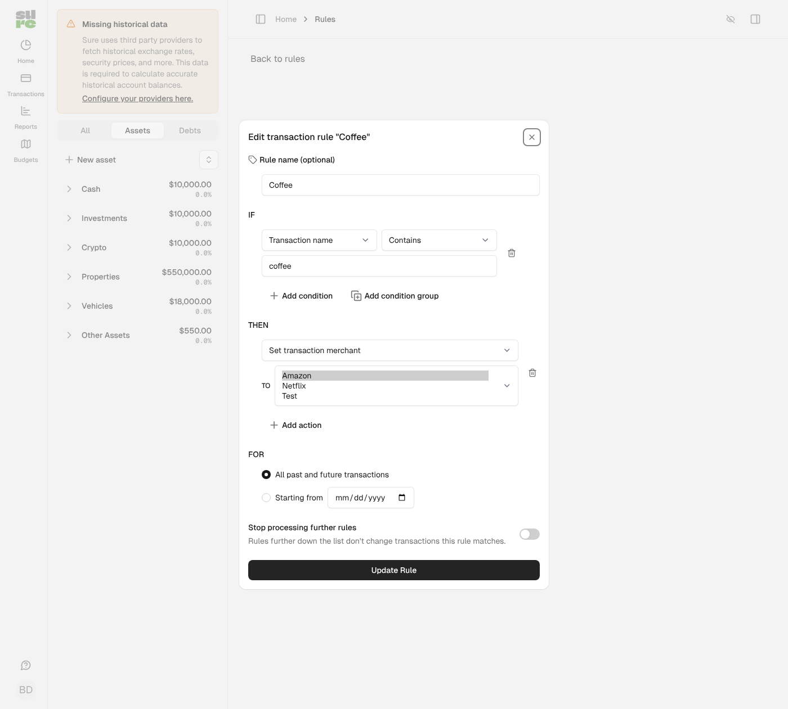
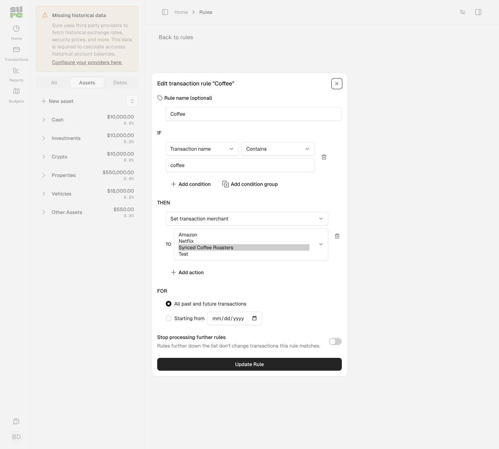

## Problem

The rule action **Set transaction merchant** only offered and applied family merchants. Merchants that came from a bank sync or AI detection (`ProviderMerchant`s) could not be picked, although the merchant **condition** already lists them (since the fix for #1197) and the transaction form, bulk edit and the assistant's transaction tools accept them.

Impact: users had to convert a synced merchant into a family merchant (which rewrites all its transactions) before a rule could assign it, and a rule that already pointed at a provider merchant (e.g. created through import) silently did nothing.

## Changes

1. **Options**: `Family#assignable_merchants_for(user)` returns the family's merchants plus the provider merchants on transactions in accounts the user can see, built with subqueries. Recently unlinked merchants are left out, so a rule can't undo an unlink.
2. **Execution** (`actionable?` / `execute`): a provider merchant is applied only while it is still on one of the family's transactions. This is checked family-wide because rules run in the background without a user. Provider merchants of other families never resolve. Shared `ProviderMerchant` records are never modified.
3. **Editing by another member**: the options are user-scoped, so `Rule::Action#options` keeps a saved merchant that is missing from them (new `ActionExecutor#option_for` hook) instead of the select falling back to the first option and overwriting the merchant on save. Its name is not shown when it is only on accounts the user can't access, or when it is unknown to the family; it is shown with "(no longer assigned)" while the family still has a record of the unlink.
4. **Assistant rule tools** (`RuleSupport#allowed_values`) accept the same merchants.
5. **Convert / merge keep rules in sync**: `Rule.replace_merchant_references!` points the family's merchant conditions (including grouped sub-conditions) and set-merchant actions at the new merchant when a provider merchant is converted to a family merchant or merchants are merged. Otherwise the next rule run would undo the conversion or merge. Other families' rules are untouched.
6. **Export / import**: merchant rule operands resolve through `family.available_merchants`, so provider merchants export by name with a `value_ref` instead of a raw UUID (which an import turned into a family merchant named after the UUID).

## Screenshots

Rule edit form, action "Set transaction merchant" for a rule that sets a synced merchant (select expanded, demo data). Before, the synced merchant is missing and the form falls back to "Amazon", so saving would overwrite the action. After, "Synced Coffee Roasters" is listed and selected.

| Before | After |
|---|---|
|  |  |

## Notes

- Balances and reports: only `merchant_id` of matching transactions changes, as with family merchants. Rule-set merchants are locked as before, and a provider-merchant action now claims `merchant_id` like any other set-merchant action.
- After an unlink, rules referencing that provider merchant stop applying it; they are not deleted, since dropping a condition would widen the rule.
- Out of scope: merchant conditions keep their existing select behaviour, and split actions keep their own merchant ids on merge.

## Validation

- New tests in `Rule::ActionTest` (apply a provider merchant, ignore another family's, options scope, saved merchant kept with a neutral label), `ProviderMerchantTest` (convert rewrites conditions, sub-conditions and actions; other family untouched), `Merchant::MergerTest`, data exporter/importer and assistant rule tool tests. Six fail on main.
- Rule, assistant, family, merchant and rules controller tests, RuboCop, Brakeman: clean.

🤖 Generated with [Claude Code](https://claude.com/claude-code)
