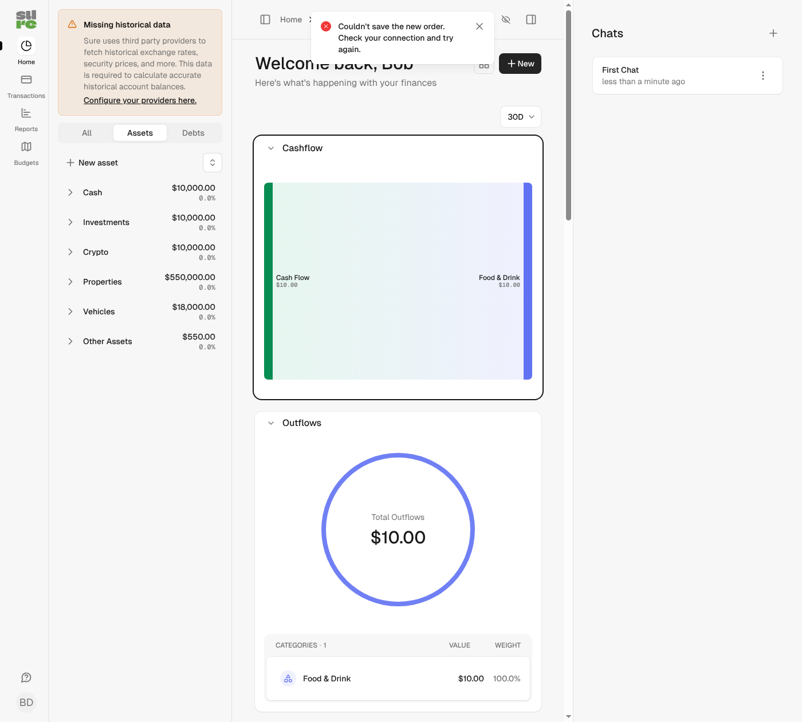

## Problem

The shared `sortable_list_controller.js` (dashboard, reports, rules, accounts sidebar) took a few gestures for a reorder, and a failed save could lose the page:

1. **Pinch zoom starts a drag.** `touchStart` ignored the number of fingers, so the second finger of a pinch restarted the hold timer. Holding still for the hold delay put the card into drag mode and the pinch moved it.
2. **Dragging text inside a card moves the card.** `dragStart` always took the item, even when the drag started on selected text, a link or an image inside it.
3. **A card dropped on its own place in the two-column dashboard grid moves.** The `nearest` drop mode excludes the dragged card from the candidates, so its nearest neighbour was always the target, even with the pointer over the card itself.
4. **A save that fails offline reloads the page.** The `catch` branch of `sendOrder` called `Turbo.visit(location, replace)`. Offline, that reload fails too and the user lands on the browser's error page.

## Changes

1. A second finger anywhere on the page cancels a pending or active touch drag (a capture listener on `document` also catches fingers outside the item). Nothing is saved.
2. Only a drag that starts on the item itself reorders; text, links and images drag natively. In account sort mode the account logo is made non-draggable like the account link, so dragging a row by its logo still moves the row.
3. While the pointer is over the dragged item there is no drop slot: no placeholder, no move, no save. Drops that leave the order unchanged no longer send a PATCH.
4. On a network error with no newer order pending, the list goes back to the last order the server confirmed, in every mirrored copy of the list too. A translated alert from a `<template>` in the notification tray says the order could not be saved, and `#aria-announcer` reads it out. Only one alert is shown, focus returns to the focused item, and only out-of-place items move, so charts inside other cards do not reconnect. A move that is still in progress (keyboard grab, drag) is left alone; its release sends the order again.
   - A save that **timed out** (`saveTimeout`, used by the accounts sidebar) may still have been stored, so it keeps reloading the page to show the server's order.
   - Non-OK HTTP responses keep the existing reload.

Client-side only: no change to endpoints, saved preferences, balances, reports, syncs or jobs. New locale key `layouts.shared.notification_tray.order_save_failed` (en, de).

## Screenshots

After: a failed offline save on the dashboard. The order is back and the alert shows (demo data):

Before, the page reloaded, which shows the browser's offline error page. The gesture fixes have no static visual difference.

## Validation

- New `test/system/sortable_list_test.rb`, one test per bug. All 4 fail on main and pass with the fix.
- Dashboard, reports, rules, accounts and manual account order system tests pass.
- RuboCop, ERB lint, Biome lint and format, Brakeman: clean.

🤖 Generated with [Claude Code](https://claude.com/claude-code)
