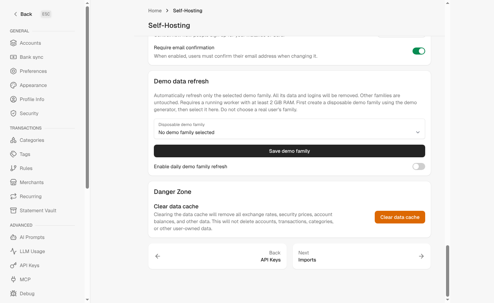
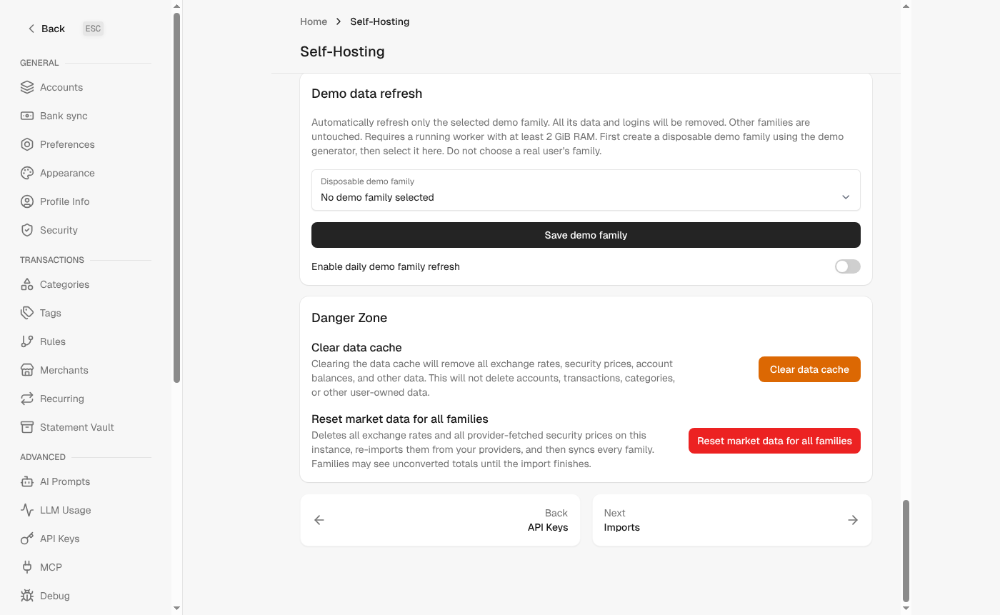

Related to #92

## Problem

Exchange rates and security prices are shared by every family on an instance. When a provider has delivered wrong or incomplete data (for example, after switching the exchange rate or securities provider), the existing "Clear data cache" only works per family. It also deletes balances and holdings, and the shared rates and prices it removes are then re-imported by parallel account syncs. During that time other families see unconverted (1:1) totals. There is no way to rebuild the shared market data once for the whole instance.

## Changes

- New Danger Zone action **Reset market data for all families** in Settings > Self-hosting. It is shown to and allowed for the super admin only, behind a high-severity confirmation.
- `MarketDataResetJob`:
  - Deletes only data a configured provider can fetch again: all exchange rates when an exchange rate provider is configured, and the prices of online securities whose assigned provider is available. Unassigned securities count when any securities provider is enabled, matching `Security#price_data_provider`.
  - Re-imports security prices and exchange rates with `MarketDataImporter` in full mode before any family syncs, then queues `SyncAllJob`, which rebuilds balances and holdings.
  - Keeps the prices of offline securities and of securities whose assigned provider is unavailable, since nothing would refetch them.
  - If one import step fails, the job logs it (logger, Sentry, `DebugLogEntry`) and still runs the other step and the syncs. The family syncs fetch whatever is still missing.
  - Holds an `until_executed` lock and does not retry, so neither a double click nor a retry deletes the re-imported data again.
- The confirmation and the flash say the reset is queued and that totals may appear unconverted until the import finishes. Strings are added in English and German.

## Screenshots

Danger Zone as seen by the super admin (demo data).

| Before | After |
|---|---|
|  |  |

## Notes

- The deletion and the re-import are not atomic. While the import runs, families may briefly see missing rates or prices; the warning text says so.
- Provider errors that `MarketDataImporter` handles internally (per pair or per security) are logged there and not reported again by the job.
- Large instances do one `DELETE` per table inside a single transaction.

## Validation

- Job tests: data is deleted before the re-import and `SyncAllJob` is queued afterwards; offline prices, balances and holdings are kept; nothing is deleted when no provider can refetch it; securities with an unavailable assigned provider keep their prices; a failing price import still imports rates and queues the syncs.
- Controller tests: the super admin can queue the reset; a family admin gets "not authorized" and nothing is queued; only the super admin sees the button.
- Hostings controller and job tests, RuboCop, ERB lint, Brakeman: clean.

🤖 Generated with [Claude Code](https://claude.com/claude-code)
