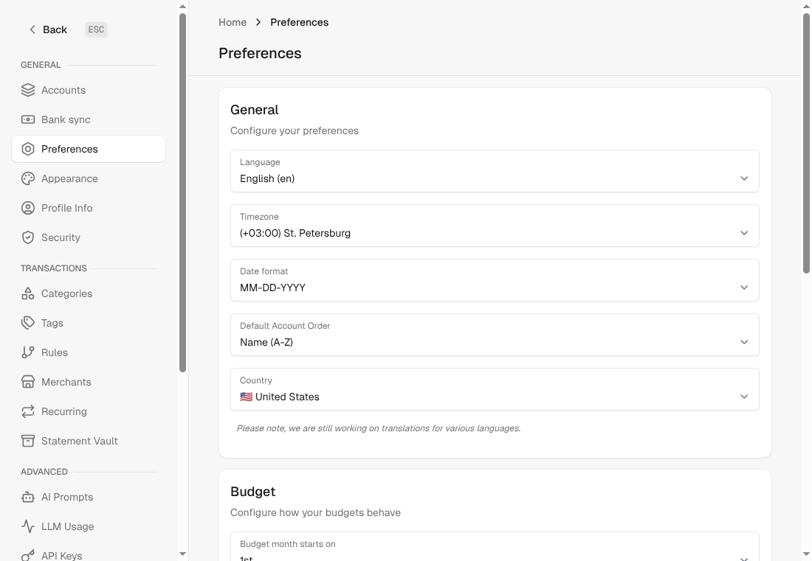
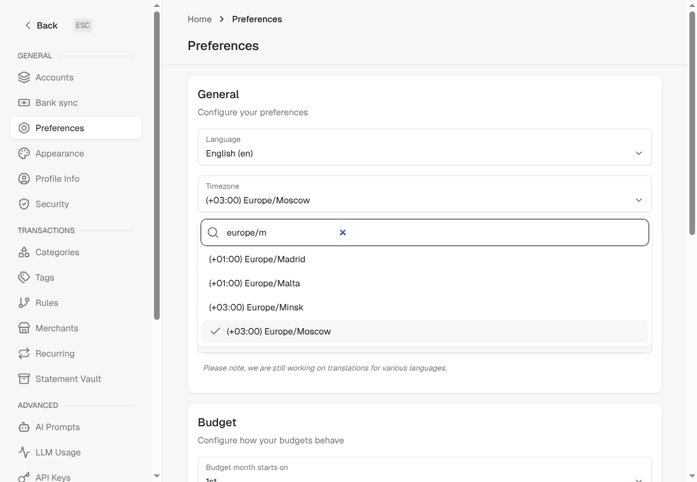

Closes #325

## Problem

The time zone select in **Settings → Preferences** used `tz.tzinfo.identifier` as the option value, but Rails maps several friendly zone names onto one IANA identifier. 27 Rails zones share only 12 identifiers (Moscow / St. Petersburg → `Europe/Moscow`, Edinburgh / London → `Europe/London`, Chennai / Kolkata / Mumbai / New Delhi → `Asia/Kolkata`, …). Every option with the saved value was marked `selected`, so the browser showed the last one: after choosing "Moscow", the page showed "St. Petersburg".

The stored value was always correct; only the display was wrong, so no data needs repairing.

## Changes

- The select lists **each IANA zone exactly once**, labelled by its identifier with the standard offset, e.g. `(+03:00) Europe/Moscow`. It uses every country zone from tzdata plus every identifier Rails ships, so all previously selectable values remain. Zones Rails never named (e.g. `America/Argentina/Cordoba`) can be chosen too.
- It is now a **searchable** `DS::Select`, like the country field next to it, so the ~330 entries stay usable.
- Rails still maps two zones to names tzdata has since renamed (`Europe/Kiev` → `Europe/Kyiv`, `Asia/Rangoon` → `Asia/Yangon`). On hosts that ship the old names as plain zone files (as GitHub's runners do), TZInfo cannot tell they are the same zone, so the old spelling is dropped whenever the new one exists. A saved value outside the list stays selectable; a saved old spelling replaces its renamed zone.
- The list is built once per process (it only depends on tzdata).
- `Family#timezone` stores `""` as `nil` (the DS select submits an empty hidden value while no zone is set, and `in_time_zone("")` would raise in provider date parsing), and stores a Rails zone name such as "Pacific Time (US & Canada)" as its IANA identifier, the value the select offers.

The `timezone_must_be_a_known_zone` validation and `Localize#resolved_timezone` are unchanged. No migration.

Trade-off: Rails' friendly names such as "Eastern Time (US & Canada)" or "Mumbai" are no longer in the labels, so users search by the IANA region/city (e.g. "new york", "kolkata").

## Screenshots (demo data)

| Before: saved `Europe/Moscow` shows "St. Petersburg" | After: saved zone shown correctly |
| --- | --- |
|  |  |

Searchable list:

## Validation

- New `test/helpers/languages_helper_test.rb`: unique option values (red on main), renamed zones listed only under their current name, all Rails zones covered, offset ordering and labels, saved old spellings and other saved zones.
- `Settings::PreferencesControllerTest`: a saved `Europe/Moscow` renders as the selected trigger text and exactly one option (red on main).
- `FamilyTest`: an empty time zone is stored as `nil`, a Rails zone name as its identifier.
- Related tests, RuboCop, ERB lint, Brakeman: clean.

🤖 Generated with [Claude Code](https://claude.com/claude-code)
