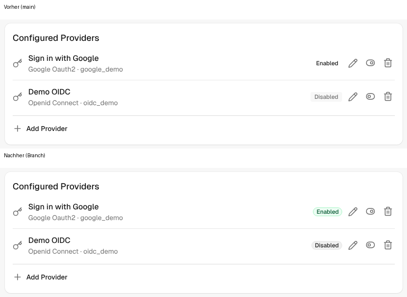
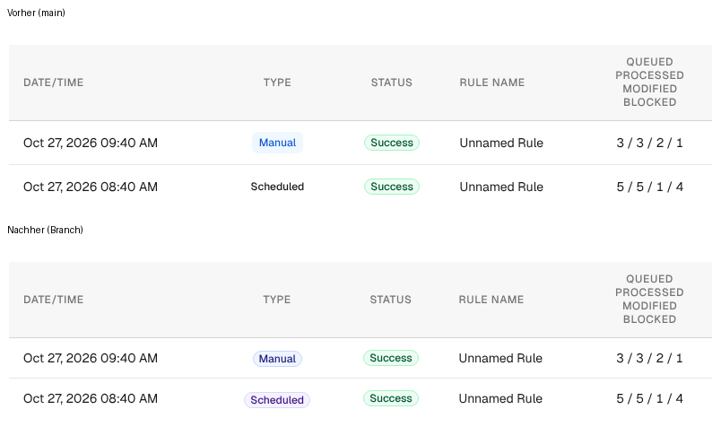
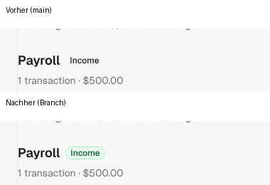

Part of #2198

## Problem

Three surfaces still built their status badges by hand with raw Tailwind palette classes:

| Surface | Badge | Old classes |
|---|---|---|
| Admin → SSO providers (provider list + "Configuration mode") | Enabled / Disabled | `bg-green-100 text-green-800` / `bg-surface text-secondary` |
| Transactions → Categorize wizard (group title) | Income / Expense | `bg-green-100 text-green-700` / `bg-surface … border-primary` |
| Rules → Recent runs | Manual / Scheduled | `bg-blue-50 text-blue-700` / `bg-purple-50 text-purple-700` |

Besides breaking the design-system rule (functional tokens only), several of these classes are not part of the compiled Tailwind build (`bg-green-100`, `bg-purple-50`, …). On main the "Enabled", "Income" and "Scheduled" badges therefore render as plain uncolored text (see screenshots).

## Change

All six spans now render through `DS::Pill` in badge mode (`marker: false`):

- Enabled / Income → `tone: :success`
- Disabled / Expense → `tone: :neutral`
- Manual → `tone: :indigo`, Scheduled → `tone: :violet` (keeps the previous blue/purple distinction)

No new keys, no CSS changes, no logic changes. Labels still come from the existing `t()` keys. The badges become `rounded-full` pills, the same shape as the run status pills next to them on the Rules page, with proper light/dark tokens.

This covers surfaces 1 and 7 of #2198 plus the rule-runs badges. The remaining item there, the assistant tool-call container (`assistant_messages/_tool_calls.html.erb`), is not a badge and is left for a separate change, so this PR does not close the issue.

## Screenshots (demo data, before = main, after = branch)

**Admin → SSO providers**

**Rules → Recent runs**

**Transactions → Categorize wizard**

## Tests

- New controller tests in `admin/sso_providers_controller_test.rb`, `rules_controller_test.rb` and `transactions/categorizes_controller_test.rb` assert the pill tone is rendered and the raw palette class is gone. All three fail on main and pass here.
- Full suite, RuboCop, erb_lint, Biome and Brakeman pass.

🤖 Generated with [Claude Code](https://claude.com/claude-code)
