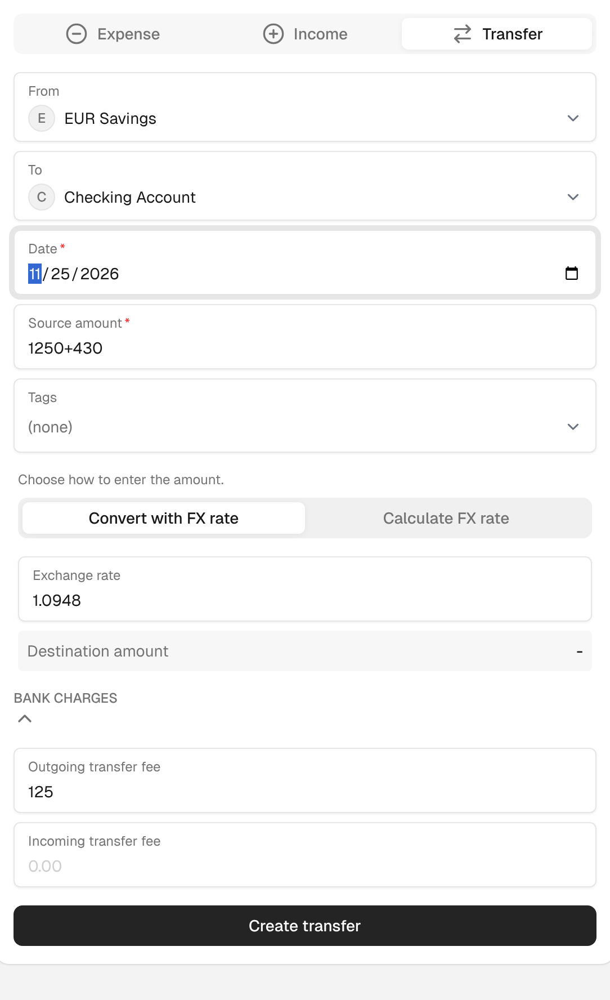
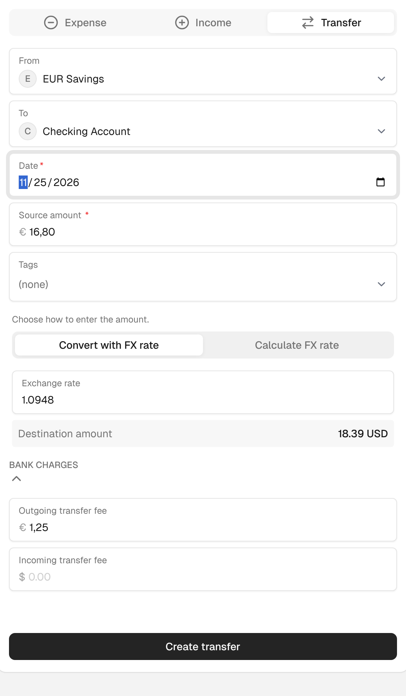
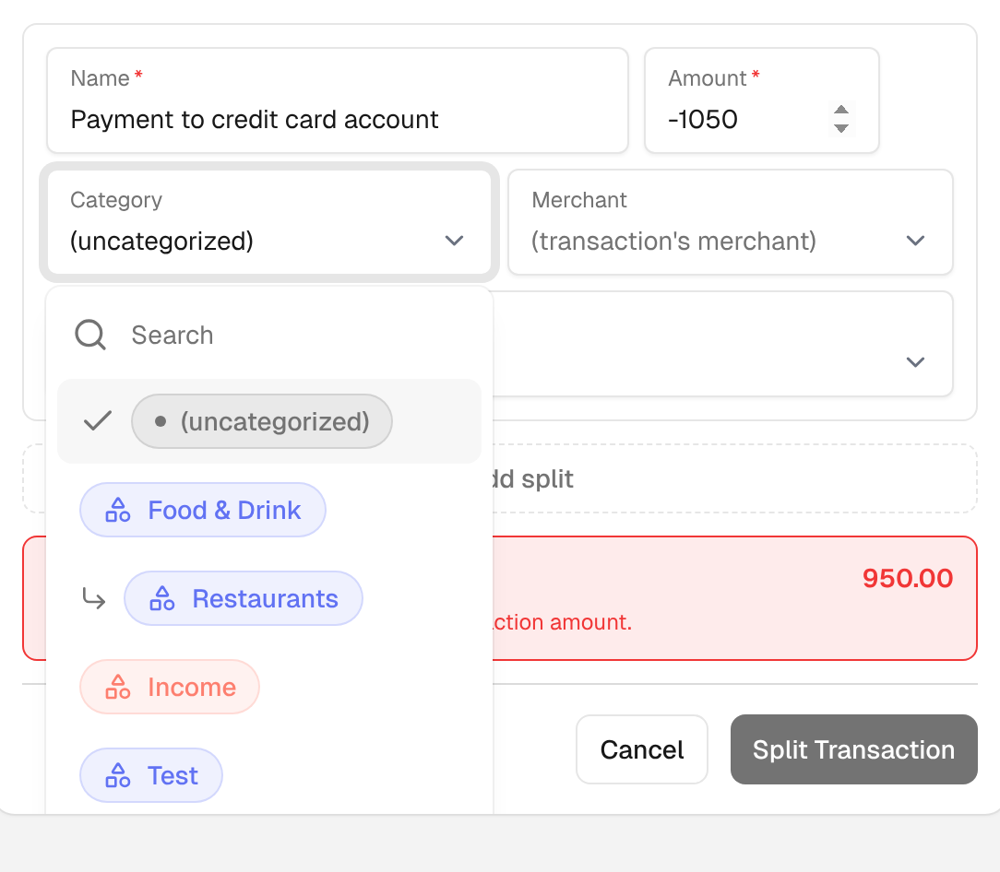
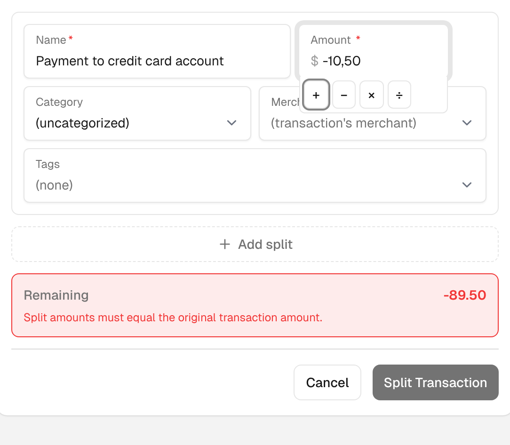
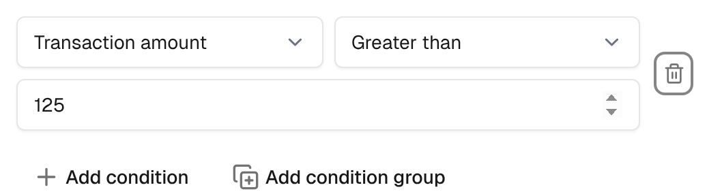
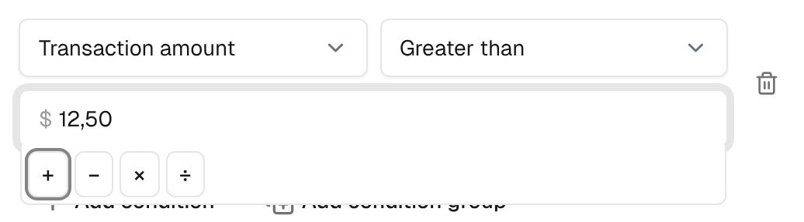
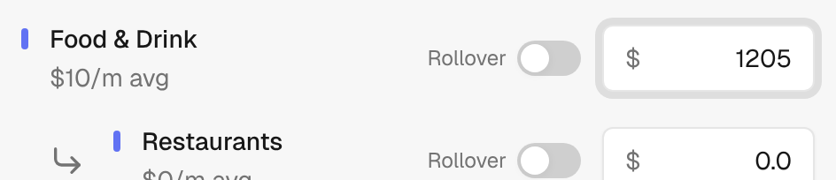
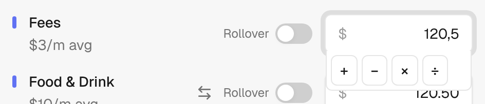

## Problem

Several amount inputs were still plain `type="number"` fields instead of the shared `money_field` introduced for the new-transaction form (upstream PR 3502). In Chromium a number input drops a comma it cannot read, so typing `12,50` into a transfer amount was sent as `1250`, and `1.234,56` as `1.23456`. Expressions (`12,50+4,30`) and pasted statement amounts did not work there either.

## Change

Every remaining amount input now uses `money_field`:

- Transfer amount and both bank charges, plus the exchange-rate destination amount
- Split rows (transaction split editor and the rule split action's fixed share)
- Budget allocation and the budget move dialog
- Credit card limits, account statement balances, convert-to-trade price, Sharesight cash anchor
- Rule amount condition, the transactions amount filter and the Monarch import balance

Supporting changes:

- `money_field` can follow an account picker through a hidden currency source, so the transfer amount and fees show the symbol and precision of the account each side belongs to.
- JavaScript that sums or compares these fields (split remaining, exchange-rate tabs, rule split summary, convert-to-trade price warning) reads them the way the field submits them. The exchange-rate tabs ask the field's controller for its submitted amount and recompute when a currency lookup lands.
- Text typed or an ambiguous paste made while a currency switch is still loading is read with the new currency's rules, not the previous one's.
- Split rows keep the decimals of saved amounts and of the total (capped at four), so an imported JPY 80.4 can still be split into amounts `Entry#split!` accepts.
- The budget allocation keeps saving when the field is left (`change`), as before, rather than on every blur.
- Saved rule amount conditions keep their stored text when the number is unchanged, so editing a rule does not re-trigger the "conditions changed" notice.

## Validation

- `bin/rails test` (unit + controller), system tests, Rubocop, ERB lint, Biome lint and Brakeman are green.
- New/updated tests: transfers, splits, budget categories and Monarch import controller tests, helper tests for `money_field_value`, rule condition model test, and `test/system/money_fields_test.rb` (comma expressions in transfers and splits, fractional JPY split totals, rule condition field, budget allocation on leave, typing during a held currency lookup).

## Screenshots

| Before | After |
|---|---|
|  |  |
|  |  |
|  |  |
|  |  |

## Notes

- No migrations.
- Upstream PR 3224 also touches `transfers/_form.html.erb`; the overlap is additive.

🤖 Generated with [Claude Code](https://claude.com/claude-code)
