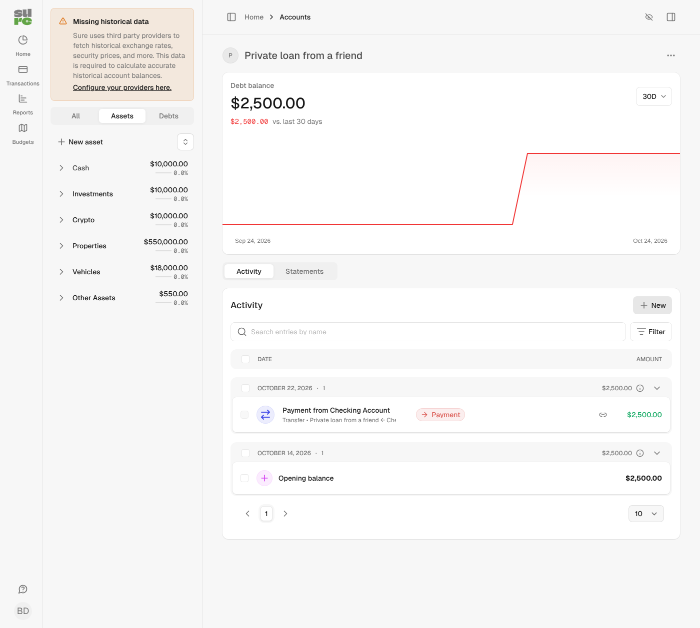
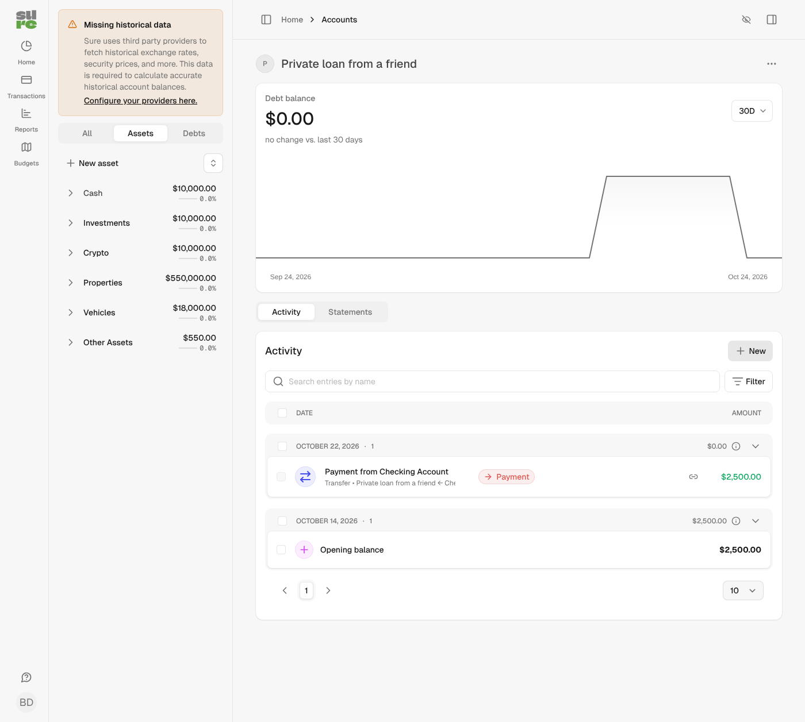

Closes #1192

## Problem

Other assets and other liabilities are valuation-tracked: their transactions never touch the balance. That is a deliberate design. But the transfer form lets you transfer into these accounts and shows the transfer as a payment. The money leaves the source account, while the other liability (or other asset) keeps its old balance, so **the money vanishes from net worth**.

Example: checking 2,500, a private loan from a friend 2,500 (other liability). Pay it back by transfer. Before this change, checking drops to 0, the debt stays at 2,500, and net worth falls by 2,500 although only a debt was repaid. The only workaround was to also set "New balance" on the liability.

## Changes

**Balance**
- `Balance::BaseCalculator`: for other assets and other liabilities, legs and fees of **confirmed transfers** now move the non-cash balance, in the forward and the reverse calculator. Standard transactions stay ignored, and so do pending auto-matches and unmatched rows that only carry a transfer kind (e.g. a provider's `funds_movement`). A split fee keeps counting through its parts. Loans keep counting every transaction; property and vehicle are unchanged.
- `Account#confirmed_transfer_transaction_ids` finds those transactions. The calculator and the balance projection (`Account#scheduled_entry_flows`) both use it, so a scheduled transfer moves the projected balance of these accounts too.
- `Account#balance_counts_transfers?` holds the account type list.
- `UI::Account::BalanceReconciliation`: the day breakdown for these accounts includes the transfer movement with the account's sign, so start + flow = end. Other account types are unchanged.
- The payment keeps its kind (`cc_payment`), so budgets and the income statement are unchanged.

**Resync**
- `Transfer` resyncs these accounts after commit when a transfer is confirmed or a confirmed transfer is removed (unlink, reject, deleting a leg or the counterpart account). Running after commit keeps callers that confirm inside their own transaction from locking an account row while holding theirs.
- Editing a confirmed transfer's amount or fees resyncs both accounts (this also closes the same gap for ordinary accounts).

**Permissions** (removing a confirmed transfer now moves the balance of an other asset or other liability)
- Unlinking or rejecting a confirmed transfer needs write access to such an endpoint, the same rule as for fee accounts.
- Deleting a transfer leg needs write access to every account the deletion changes (fee accounts and such a counterpart), in the web delete, bulk delete, the API and the assistant's delete tool. Bulk delete skips these entries and says why. The changed accounts resync in full.
- Splits are left to the refusal from #4966: a split whose part is a confirmed transfer leg cannot be unsplit, resplit or deleted.
- "Set as Transfer/Payment" rule: the target select lists only accounts the user can edit, and a newly picked target is validated (a target another member saved stays valid). The rule skips excluded transactions (split parents among them) and the target's own transactions; split parts can be linked.

**Copy**
- The other-asset form notice says transfers still change the balance (all locales).

## Screenshots

Other liability opened at $2,500, then paid back with a $2,500 transfer from checking (demo data).

| Before | After |
|---|---|
|  |  |

## Notes

- Existing accounts pick the change up on their next sync; there is no migration. Their history (net worth, balance sheet, charts) is recalculated then.
- A "New balance" entered on or after the payment date still wins. One dated before a later payment now has that payment applied on top.
- Deleting the account that paid removes the transfer; the leg on the liability becomes a standard transaction and stops counting.
- `Transfer::Matcher#match_with!` still refuses split parts, while the rule now links them as #4966 and #4955 expect.

## Validation

- Forward and reverse calculator tests with a real confirmed transfer, a standard transaction, an unmatched `funds_movement` row, a destination fee and a split fee; a `Transfer::Creator` payoff reaching 0. Projection test with a scheduled confirmed transfer, a standard transaction and a pending match. These fail on main.
- Transfer tests: resync on confirm, unlink and leg deletion, none when a pending match is rejected. Controller, API and assistant tests for the delete and unlink permissions; split tests keep the #4966 answer.
- Balance, transfer, account, entry, split, rule, transaction, component and assistant tests (2,077 runs), RuboCop, Brakeman: clean.
