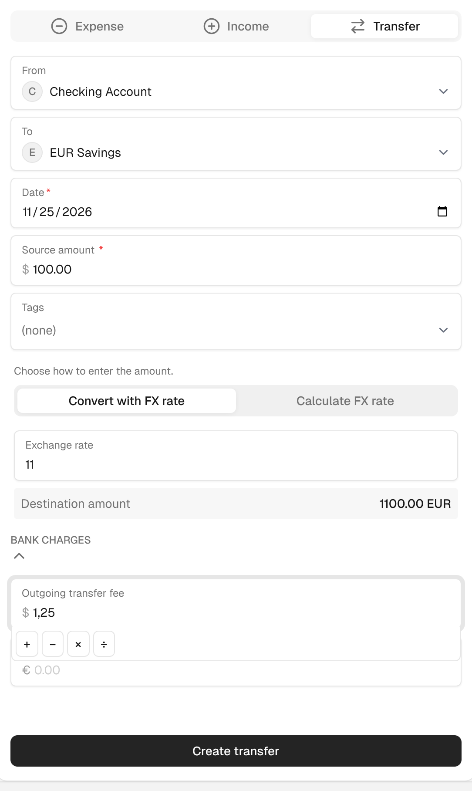
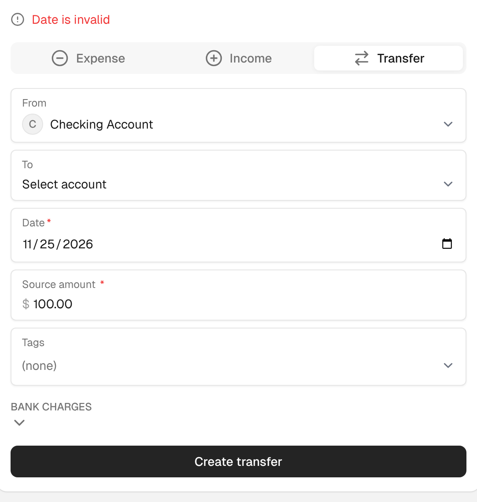
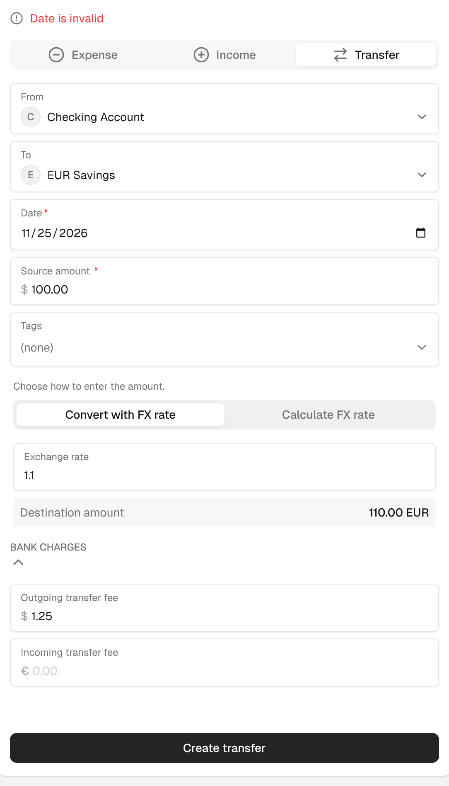

Stacked on #5833: the base is a copy of that PR's branch, so the diff shows only this change. Once #5833 is merged, this PR's base moves to `main`.

## Problem

1. When a transfer was rejected (invalid date, missing exchange rate, same account on both sides, or a stale form), the form came back with **To** reset to "Select account". The date, the bank charges and the exchange rate were gone too. Everything except the source account and amount had to be entered again.
2. The exchange rate in the transfer and transaction forms was still a `type="number"` input. In Chromium, `1,1` was submitted as `11`.

## Change

- `TransfersController#create` redraws every rejection through one `render_new_with_submitted_input`. It keeps the destination account, the date, both fees, the tags and the exchange rate. A fee or rate that is not plain decimal text, such as a submit without JavaScript or exponent notation, is dropped rather than shown as a different number.
- Model validation errors (for example, the same account on both sides) now redraw the form instead of raising. A zero rate or a negative fee is reported as an invalid amount, not as an invalid date. A stale form gets a fresh idempotency key, so the next submit is not rejected again.
- The form selects the kept destination account and opens **Bank charges** when a fee was given. The exchange-rate controller keeps a redrawn rate on the lookup it starts on connect, instead of overwriting it with the market rate. A later lookup, after another account or date is picked, replaces it as before. On the calculate tab, a lookup recomputes the rate from the typed amounts.
- The exchange rate in both forms is now a money field with no symbol and no rounding (`step: "any"`), so a comma decimal or an expression (`1/0,92`) works. Pasting `0,925` reads it as typed (0.925), because a rate has no currency to settle the separator. Unrounded amounts keep 15 significant digits, so tiny rates survive.
- `money_field` accepts `raw_value:` for a value that is not a currency amount and must be shown as given. The transaction form uses it, so an invalid rate is shown as typed instead of raising in `sprintf`.

## Screenshots

| | Before | After |
|---|---|---|
| Rate `1,1` typed |  |  |
| After a rejected submit |  |  |

Before, the rate `1,1` was submitted as `11`. After, it is `1.1`, and a rejected submit keeps the destination, the date, the fees and the rate.

## Validation

- Controller tests check that a rejected transfer keeps the destination, the date, the fees and the rate, and that a non-numeric fee or an exponent rate is dropped. They also cover the same account on both sides, a zero rate reported on the amounts, a stale form getting a fresh key, and a rejected transaction showing an invalid rate as entered.
- A system test checks that a transfer's exchange rate reads a comma decimal: the destination shows 110.00 EUR and `1.1` is submitted.
- JavaScript unit tests cover tiny rates and large unrounded amounts.
- Checked in the transfer dialog of a local instance (screenshots above). A rejected submit keeps every field, and a rate of `1,1` converts 100 USD to 110.00 EUR.
- No migrations.
